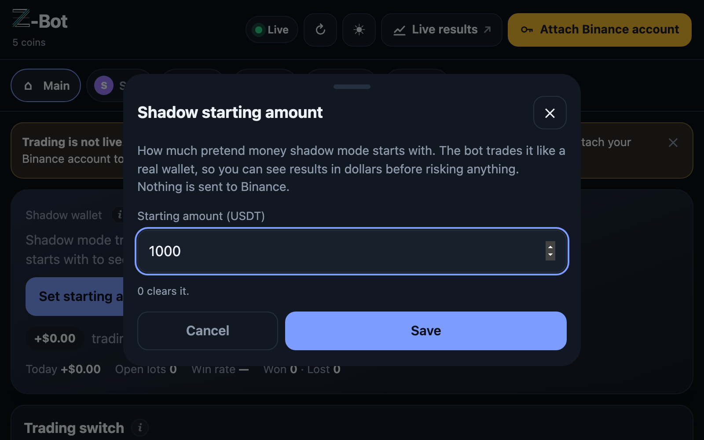

<p align="center"></p>

# Z-Bot

[](https://github.com/zulfi011/z-bot/actions/workflows/ci.yml)
[](LICENSE)
[](https://zulfi011.github.io/z-bot/)

Open-source crypto trading bot for Binance spot. More than 130 backtest experiments, every one published with its
report ([index](research/INDEX.md)). Most ideas failed; the few that held up on data they were never tuned on trade
SOL, ETH, BTC, AAVE and TRX.

**Results:** <https://zulfi011.github.io/z-bot/>. Every trade of a simulated account at Binance spot prices, after
fees, in percentages, updated daily, red months included.

- **Tested strategies, not guesses.** Each coin's settings were chosen on two years of 1-minute data and then checked on
  periods the search never saw. The ideas that failed are published too.
- **Try it with no money.** It starts in *shadow mode*: real prices, every decision worked out, pretend money, nothing
  sent to Binance.
- **Your keys, your machine.** Attach your own Binance account when you are ready. The bot can trade but never
  withdraw, and every position has its stop-loss parked on Binance itself.

<p align="center"></p>
<p align="center"><sub>A fresh install in shadow mode: pretend money, real prices.</sub></p>

## Quickstart (5 minutes, no account needed)

You need [Docker](https://docs.docker.com/get-docker/).

```bash
git clone https://github.com/zulfi011/z-bot.git
cd z-bot/engine
docker compose up -d --build
```

Then open the dashboard in your browser (port 3000 on your computer). The first start downloads a month of prices, so give it a few minutes. Then:

1. **Set starting amount** on the Shadow wallet card (pretend money, e.g. 1000).
2. Switch a coin on in the **Shared pot** card.
3. Watch it work. Every card has an **(i)** that explains it in one or two sentences.

The dashboard only listens on your own computer. Stop it with `docker compose down`.

## How it works

```
prices ──▶ strategy rules ──▶ buy one lot from the shared pot ──▶ stop-loss parked on Binance ──▶ sell
(1-minute)  (per coin)          (shadow: pretend money)             (from the first minute)        (trailing stop or trend ride)
```

Each coin watches its own average and buys in a few tested ways. All coins share one pot of equal lots, first come
first served. More in [How it works](docs/guide/HOW-IT-WORKS.md).

## Strategies at a glance

| Ways in | | Ways out | |
|---|---|---|---|
| **Dip** | the price dips into its average and a green candle confirms | **Stop-loss** | a set % below the buy, parked on Binance |
| **Quiet-band breakout** | the price breaks out of a quiet, narrow range | **Trailing stop** | after a set gain, follows the price and keeps most of it |
| **Pullback** | a short dip in a clean uptrend (ETH) | **Trend ride** | in a clean uptrend, holds until the trend line breaks |
| **Add-ons** | adds to a winning lot (SOL, off by default) | **Break-even floor** | a trend-ride lot in profit can no longer close at a loss |

Every coin's exact settings: [Strategies](docs/guide/STRATEGIES.md).

## Guide

| | |
|---|---|
| [How it works](docs/guide/HOW-IT-WORKS.md) | The loop, shadow vs live, the shared pot |
| [Strategies](docs/guide/STRATEGIES.md) | Every way in and out, and each coin's settings |
| [Using the dashboard](docs/guide/USER-GUIDE.md) | Every card and button, and the tested defaults |
| [Safety](docs/guide/SAFETY.md) | Keys, stops on Binance, keeping the dashboard private |
| [Run it on a server](docs/guide/DEPLOY.md) | A small cloud server and attaching Binance |
| [Research](docs/guide/RESEARCH.md) | How the strategies were tested, and what failed |

## Repository

| Folder | What is in it |
|---|---|
| `engine/` | The bot: worker, API, dashboard, Docker setup, strategy files |
| [`research/`](research/README.md) | Data processing, backtests and every experiment's report ([index](research/INDEX.md)) |
| `docs/` | The public results page and this guide |

## Disclaimer

Not financial advice. Crypto trading can lose money. The results are from one simulated account and the backtests are
history; neither predicts what happens next. Run it in shadow mode first, and only trade money you can afford to lose.

## Contributing

Bug reports and ideas are welcome in [Issues](https://github.com/zulfi011/z-bot/issues). Before a pull request, read
[CONTRIBUTING.md](CONTRIBUTING.md): it has the setup, the tests and the project's rules (honest results only, no
built-in money, safety first). Security problems go through private reporting, see [SECURITY.md](SECURITY.md).

## Author

Built by **Zulfi** · [LinkedIn](https://www.linkedin.com/in/zulfi0) · [GitHub](https://github.com/zulfi011)

## Licence

[AGPL-3.0](LICENSE). You can use, change and share Z-Bot freely. If you share a changed version, or run one as a
service for other people, you must publish your source code under the same licence. The software comes with no
warranty (sections 15 and 16 of the licence).
