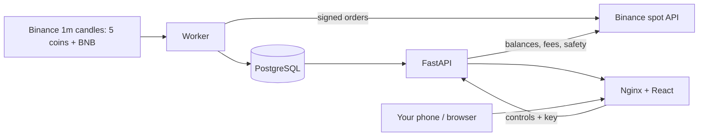

# Architecture

## Goal

Run the SOL, ETH, BTC, AAVE and TRX strategies continuously on a real Binance spot account: money stays in the
Binance wallet, the app decides and executes, every lot is protected by a stop-loss order on Binance, restarts lose
and duplicate nothing, and a phone-friendly dashboard shows the money, the trades and the profit after all costs.

## Runtime

- `worker`: backfills and streams closed 1-minute candles, runs one signal engine per coin (SOL 3m/12-day,
  ETH 5m/7-day, BTC 5m/5-day with a close-above-30-day-average confirmation, AAVE 3m/10-day, TRX 1m/12-day with
  that confirmation capped at 10% above the average), the quiet-band break finder for the coins that have it and ETH's
  pullback entry (`pullback_service.py`, which keeps its 24-hour line in `engine_state` and re-warms it from stored
  candles), then runs the live execution engine per coin - which also decides the pyramid adds, since those depend
  on open lots rather than on candles alone - then the health checks. It re-reads the trading mode every cycle,
  so Stop all / Shadow / Live take effect without a restart.
- `api`: read model (`/api/v1/dashboard` with `binance`, `trading`, `money` and a `coins` section,
  `/api/v1/equity-history`, `/api/v1/leaderboard?period=`, `/api/v1/profit?period=`, `/api/v1/profit/trades.csv`)
  and controls. Pot, coin switch and mode controls are applied straight away (`/settings/trading`, `/pot`,
  `/coins/{symbol}/trading`); buy-now and close still queue in `control_requests` because they belong to a minute.
- `web`: compiled React app; `/api` is proxied to FastAPI.
- `binance_client.py` is the only module that touches the API secret. It signs with HMAC-SHA256, corrects the
  timestamp against Binance's server clock, and turns every Binance error code into a sentence the dashboard can
  show. `binance_exchange.py` builds the orders against `exchangeInfo` rules; in shadow mode it prepares the same
  order and returns it unsent.

## Per-coin cycle

Each coin has its own cursor (`engine_state.live_execution`) and walks forward one stored candle at a time. A coin
starting for the first time begins at the newest candle instead of replaying history.

1. **Open lots.** If Binance's parked stop filled, record the real fill, fees and P&L. Otherwise apply the coin's
   exit rules (stop, trailing stop) and any pending manual close. A protective-stop exit is left to Binance's own
   order; a trailing-stop or manual exit cancels that order and sells at market.
2. **Entries.** Confirmed signals for that minute, then pending "buy now" requests. A lot opens only if: the coin
   is switched on, the mode is not `off`, one of the shared pot's lots is free (open lots are counted across every
   coin), the maximum open value and the daily loss limit are not passed, and Binance has some free USDT (a full lot,
   or whatever is left). A blocked signal is stamped with the reason.
3. **Buy.** `quoteOrderQty` market buy (spend exactly the lot), then a `STOP_LOSS_LIMIT` stop at
   fill × (1 − stop%) with the limit just under the trigger. A fee taken in BNB leaves the coin quantity whole; a
   fee taken in the coin itself reduces what can be sold. If the stop order fails, the lot is recorded and an alert
   says it is unprotected.
4. **Snapshot.** Free and locked USDT, BNB and its value, allocated money, open lots and their cost and value,
   realized / unrealized / strategy P&L, wallet value, fees and the current mode.

## Data

- `candles_1m` (every coin plus BNBUSDT), `daily_averages` (7/15/30-day and each coin's signal average).
- `touch_episodes`, `signals`: every touch and its decision (bought, skipped 06–12 UTC, downtrend, blocked …).
- `positions`, `orders`, `trades`: lots and fills with their Binance order ids, the fee asset and
  the fee amount; positions also hold the parked stop's id and price and the quantity actually sold.
- `exchange_events`: every order request and Binance's reply, including shadow orders — the audit trail.
- `coin_allocations`: each coin's on/off switch (`trading_enabled`) and extra-entry toggles; its old lot columns are
  unused since the shared pot (migration 0022).
- `control_requests`: buy-now and close — pending → applied/rejected with a reason.
- `account_snapshots`: one row per cycle, describing the real wallet.
- `engine_state`: per-coin cursors, the activation boundary and `account_settings` (mode, daily loss limit,
  maximum open value, and the shared pot: `pot_lots`, `pot_lot_size_usd`); `monitoring_alerts`, `system_events`.

There is no internal cash ledger: the wallet is whatever Binance reports.

## Reliability

- Money is never simulated, so the old cash-ledger recovery is gone. Instead the engine reconciles against Binance:
  the parked stop's status decides whether a lot is still open, sell quantities are clamped to the real free
  balance, and real commissions are read back from `myTrades`.
- Binance rules (minimum notional, quantity step, price tick) are checked before anything is sent; a lot that is too
  small is refused with an explanation instead of being rejected by the exchange.
- A failed buy or sell leaves the ledger unchanged and raises an alert; the worker keeps running and always runs the
  health checks, even if a trading call raised.
- Alerts: stale prices and gaps per coin, execution lag, daily loss limit reached, open lots with no stop order on
  Binance, low BNB for fees, and shadow/off mode.
